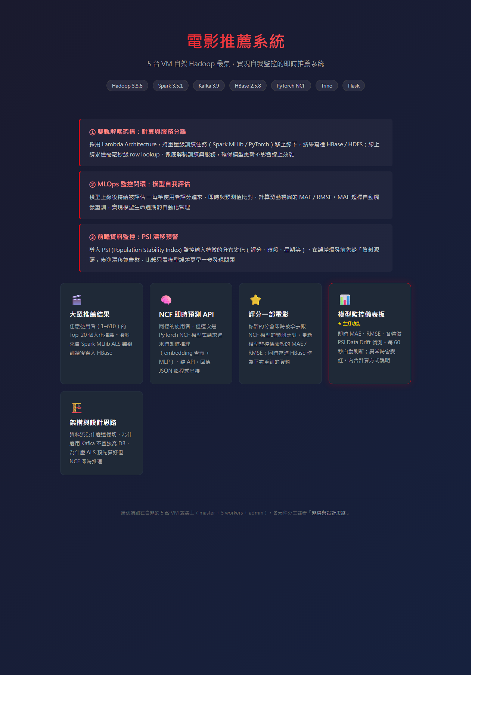
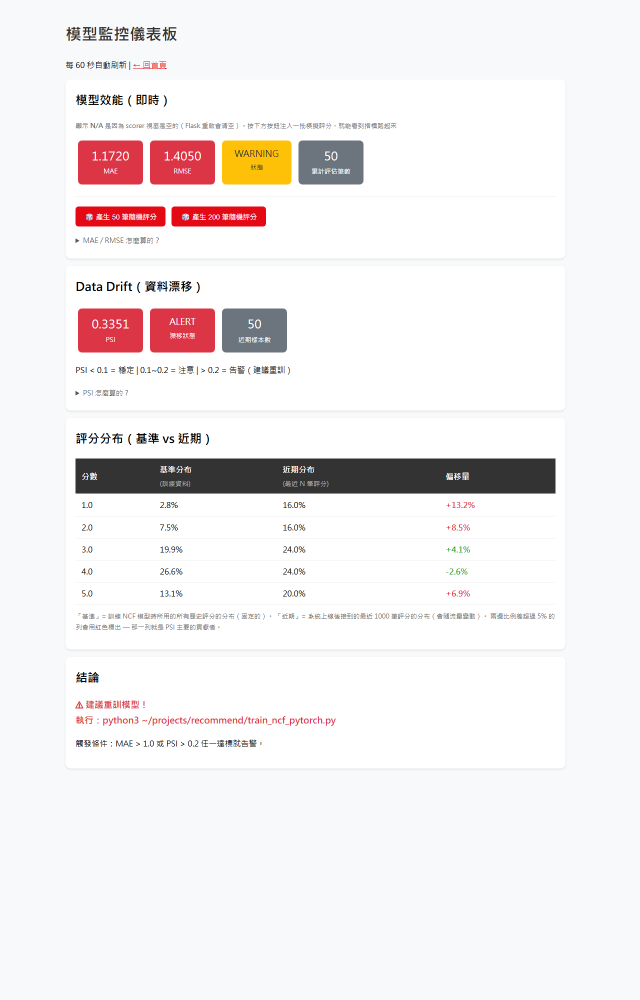
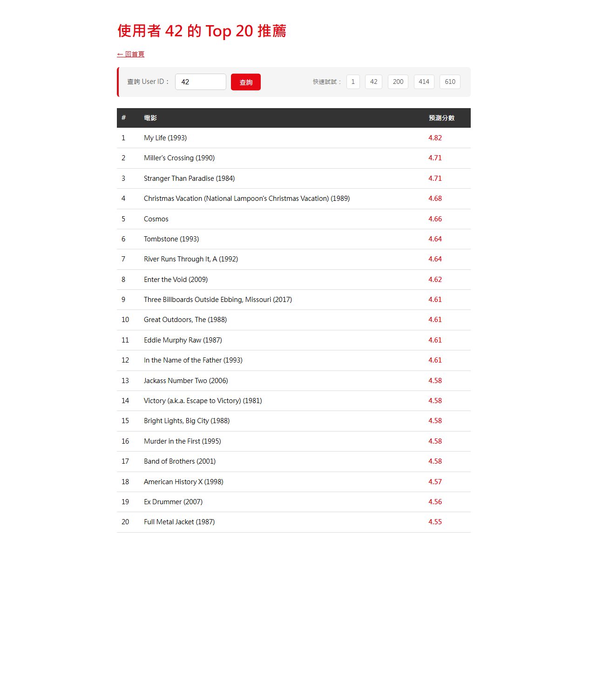
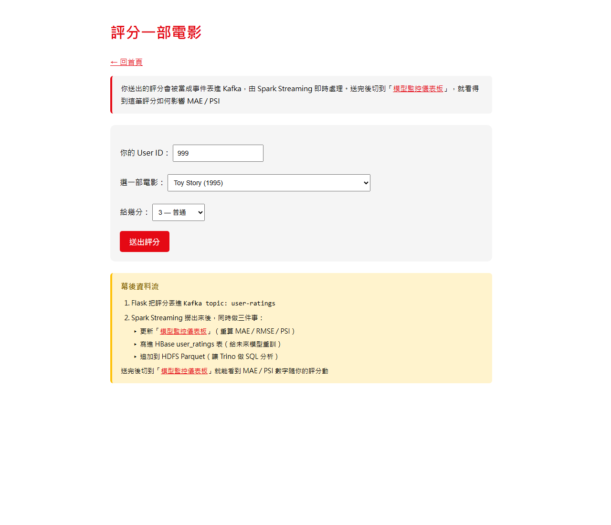

# 電影推薦系統｜即時推薦 + 模型監控（NCF / Lambda 架構）

在 **5 台 VMware VM 組成的 Hadoop 叢集**上，自建的即時電影推薦系統。涵蓋離線模型訓練、即時推薦服務、以及上線後的模型效能與資料漂移監控，是一套端到端（end-to-end）的機器學習系統實作。

> 自主學習專案（個人練習，非商業專案）。資料集為公開的 MovieLens。

---

## 系統架構

5 台 VM 的 Hadoop 叢集，採 **Lambda 架構**（批次層 + 速度層）：

| 角色 | 節點 | 主要服務 |
|---|---|---|
| Master | master | NameNode、ResourceManager、HBase Master |
| Workers ×3 | worker1 / worker2 / worker3 | DataNode、NodeManager、Kafka Broker、RegionServer |
| 閘道 / 服務 | admin | SecondaryNameNode、Flask Web 服務 |

- **批次層（Batch）**：Spark MLlib 產生離線推薦，結果寫入 HBase。
- **速度層（Speed）**：使用者評分事件經 Kafka 串流，即時更新模型監控指標。
- **模型層（Model）**：PyTorch 自建 **NCF（Neural Collaborative Filtering）** 模型，提供即時 Top-20 推薦。

## 技術棧

`Hadoop (HDFS/YARN)` · `Spark MLlib` · `PyTorch` · `Kafka` · `HBase` · `Flask` · `Python (pandas/numpy)`

## 功能

- **即時推薦**：`/recommend`（HBase 預算好的 Top-20）與 `/api/ncf_recommend/<uid>`（NCF 即時線上運算）。
- **評分回饋**：`/rate` 將使用者評分送進 Kafka 事件流。
- **模型監控儀表板**：`/monitor`
  - **模型效能**：滑動視窗 MAE / RMSE（預測 vs 實際評分）。
  - **資料漂移（Data Drift）**：以 **PSI**（Population Stability Index）比較訓練基準分布與近期流量分布。
  - **告警邏輯**：`MAE > 1.0` 或 `PSI > 0.2` 任一達標 → 顯示 **WARNING / ALERT** 並升起 `need_retrain` 旗標，提示人工重訓（非自動觸發重訓管線）。

## 模型效能

NCF 模型離線測試集 **RMSE ≈ 0.90**。

> 註：監控儀表板上看到的 RMSE/MAE 是「上線後滑動視窗」指標，示範時以隨機模擬評分注入，故數字會偏高、用來展示告警機制；與離線測試集的 0.90 是兩回事。

## 畫面

| 首頁 | 監控儀表板 |
|---|---|
|  |  |

| 推薦（桌機） | 評分 |
|---|---|
|  |  |

響應式設計（RWD），手機版畫面見 `screenshots/*_mobile.png`。

## 檔案說明

| 檔案 | 說明 |
|---|---|
| `app_v2.py` | Flask 主程式：推薦 API、NCF 即時推論、Kafka 生產者、模型監控（MAE/RMSE/PSI）。 |
| `compare_models.py` | 離線模型比較（不同演算法 / 參數的效能比較）。 |
| `multi_feature_psi.py` | 多特徵 PSI 資料漂移分析。 |
| `*.html` | 前端頁面（Flask 模板）。 |
| `screenshots/` | 系統實際執行截圖。 |

---

*資料集：[MovieLens](https://grouplens.org/datasets/movielens/)。叢集主機名（master/worker）為內網拓撲，非機密資訊。*
